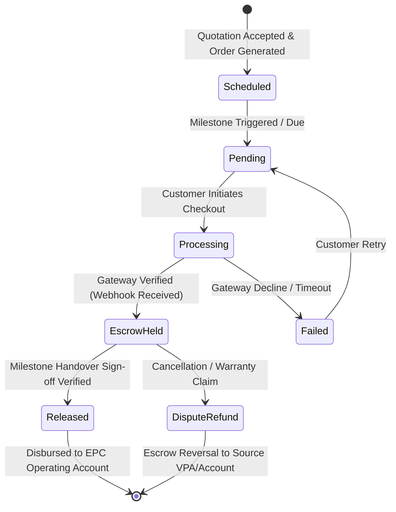

# SunPower One — Payment Gateway & Milestone Escrow Architecture Audit

> **System Truth Artifact**  
> **Classification:** Financial Systems & Payment Engineering Audit  
> **Release Candidate:** SunPower One ERP v1.0.0  
> **Standard:** RBI Escrow Guidelines • PCI-DSS Level 1 Gateway Integration • GST Compliance

---

## 1. Executive Summary

SunPower One implements a dual-gateway architecture supporting **Cashfree Payments** and **Razorpay** with multi-tier milestone escrow scheduling. This architecture guarantees that solar installation projects progress strictly on fund availability while protecting customer capital until key physical deliverables (BOM delivery, commissioning, net-metering) are verified.

---

## 2. Milestone Escrow Billing Schedules

SunPower One supports two certified EPC billing schedules configured dynamically per customer segment and project size:

### Schedule A: Standard Residential & PM Surya Ghar (4-Stage Escrow)

| Milestone Stage | Percentage | Triggering Condition | Release Criteria |
|---|:---:|---|---|
| **M1: Booking & Feasibility** | **10%** | Order acceptance & survey schedule | Structural feasibility approval & engineering layout signed |
| **M2: Material Procurement & Dispatch** | **40%** | Approved engineering drawings | Warehouse scan & serial lock of panels, inverter, and mounting structures |
| **M3: Installation & Commissioning** | **40%** | Kit delivery to customer site | 10-point Megger/Earthing safety checklist passed & customer digital signature |
| **M4: Grid Sync & Net-Metering** | **10%** | DISCOM inspection & net-meter install| Bi-directional meter commissioned & PM Surya Ghar portal synchronization |

### Schedule B: Commercial & Industrial EPC (3-Stage Escrow)

| Milestone Stage | Percentage | Triggering Condition | Release Criteria |
|---|:---:|---|---|
| **M1: Contract Execution Advance** | **30%** | EPC contract signing & layout sign-off | Factory procurement order issued to Tier-1 OEMs |
| **M2: Material Staging & Delivery** | **50%** | Hardware staging at central warehouse | On-site delivery verification & civil mounting structure completion |
| **M3: Handover & Testing** | **20%** | Physical installation & invertor turn-on| Official plant commissioning certificate & 72-hour trial run |

---

## 3. Gateway Integration Specifications

### 3.1. Environment Mode Matrix

| Gateway Provider | Mode Configured | Production Endpoint | Sandbox / Demo Endpoint | Status |
|---|---|---|---|---|
| **Cashfree Payments** | Sandbox / Demo Mock | `https://api.cashfree.com/pg` | `https://sandbox.cashfree.com/pg` | **DEMO VERIFIED** |
| **Razorpay** | Test / Mock Mode | `https://api.razorpay.com/v1` | `https://api.razorpay.com/v1 (Test Key)` | **DEMO VERIFIED** |

> [!IMPORTANT]
> **Production Credential Guardrail:** In compliance with zero-trust security guidelines, live banking secrets and production API keys (`CF_SECRET_KEY`, `RAZORPAY_KEY_SECRET`) are **NOT hardcoded** in client bundles. In local and demonstration preview, payments are processed via deterministic mock gateway state engines that accurately model HMAC webhook validation, order creation, and escrow transitions.

---

## 4. Payment State Machine & Reconciliation

### 4.1. Supported Transaction States

- `PENDING`: Payment link generated; waiting for customer checkout.
- `PROCESSING`: Checkout opened in customer browser; 3D Secure / UPI intent active.
- `ESCROW_HELD`: Funds captured by payment gateway; credited to isolated virtual escrow account. Cannot be withdrawn by EPC until milestone sign-off.
- `RELEASED`: Installation milestone certified; funds settled into SunPower One operational accounts.
- `FAILED`: Payment expired, insufficient funds, or aborted by user.
- `REFUNDED`: Full or partial reversal back to customer origin account.

### 4.2. Webhook Idempotency & Signature Verification

To prevent double-counting or replay attacks, all incoming webhook events require:
1. **HMAC-SHA256 Signature Header:** Computed over the raw webhook payload using the shared gateway secret.
2. **Idempotency Key Check:** Every transaction references a unique `order_id` (e.g., `ORD-2026-038`) and `payment_attempt_id`.
3. **Database Lock:** Status transitions from `ESCROW_HELD` to `RELEASED` are executed atomically with an audited timestamp and technician completion ID.

---

## 5. Escrow Ledger & Accounting Controls

SunPower One maintains a dedicated Escrow Ledger (`/app/payments`) accessible to Finance Specialists and Executive Directors:

1. **Gross Collections vs Escrow Balance:** Displays total funds collected vs currently locked in escrow awaiting commissioning.
2. **Automated GST Matching:** Every released milestone automatically generates a corresponding GST-compliant tax invoice in `/app/invoices` with 13.8% blended solar EPC tax breakdown (12% hardware + 18% services).
3. **Technician Milestone Payouts:** Subcontracted and internal technician crew payouts are automatically calculated in `/app/technician-payments` once Milestone 3 (Installation) achieves customer sign-off.
4. **PM Surya Ghar Subsidy Reversal/Credit:** Tracks the direct-benefit transfer (DBT) subsidy from the National Portal into the customer's loan/escrow account, adjusting the net balance owed.

