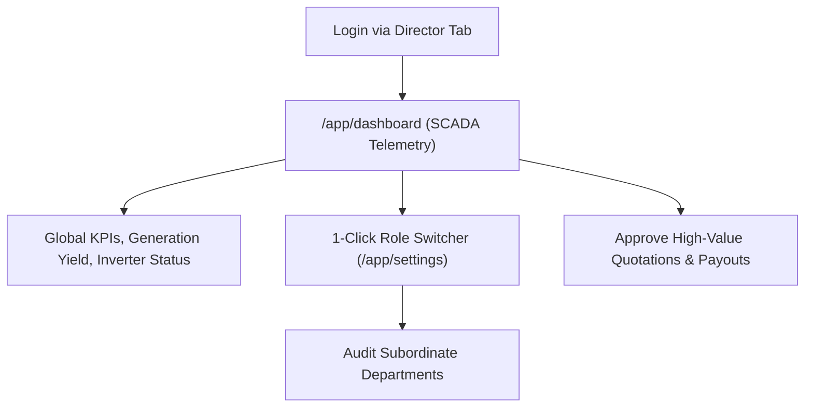
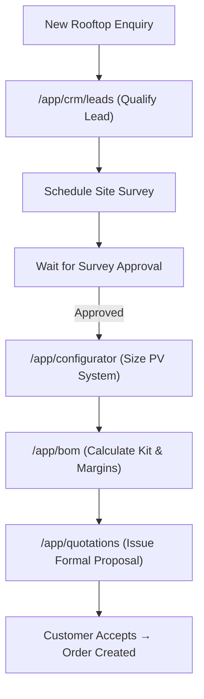
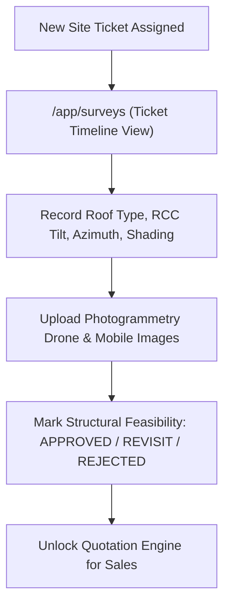
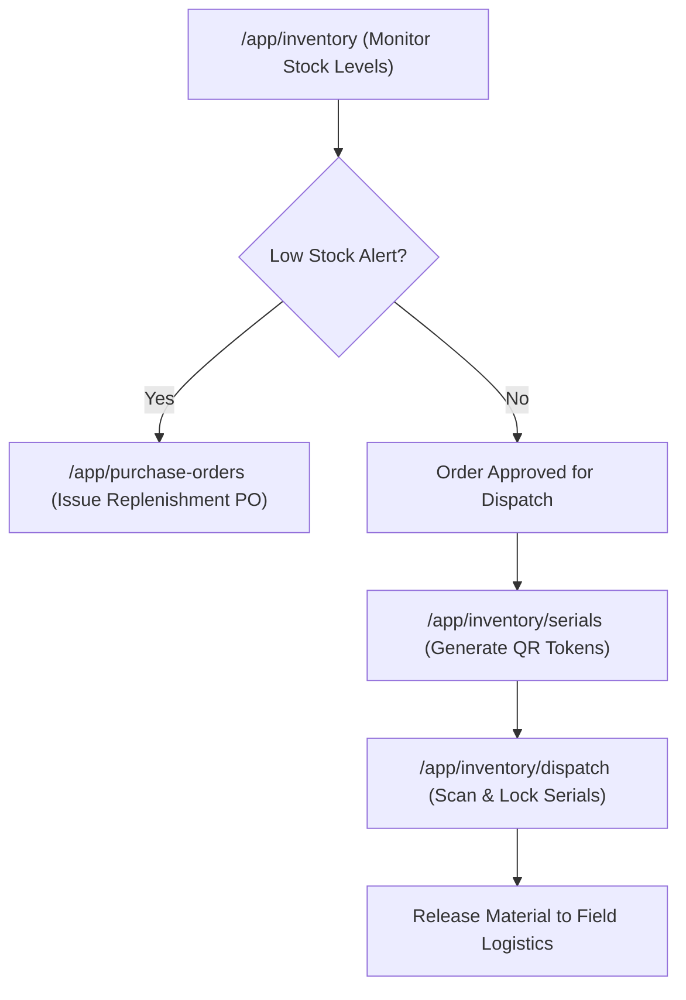
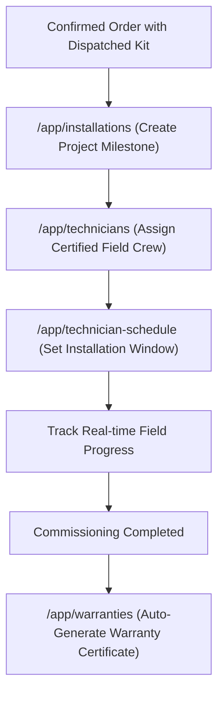
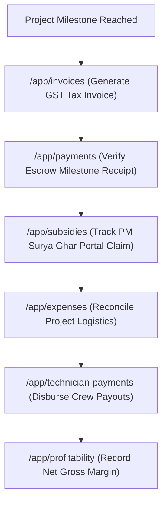
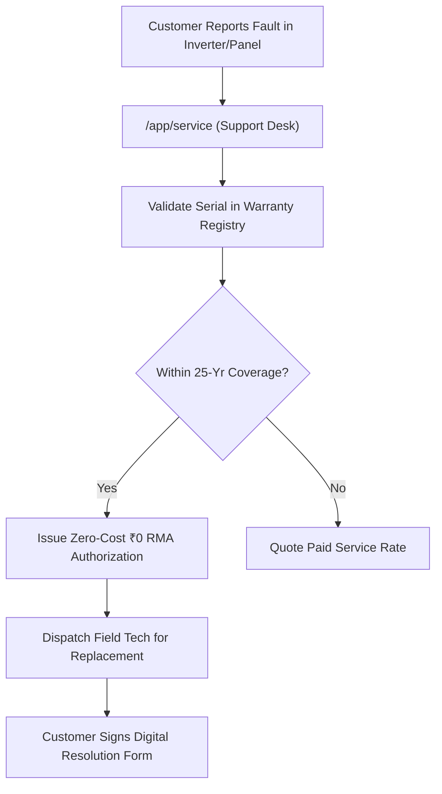
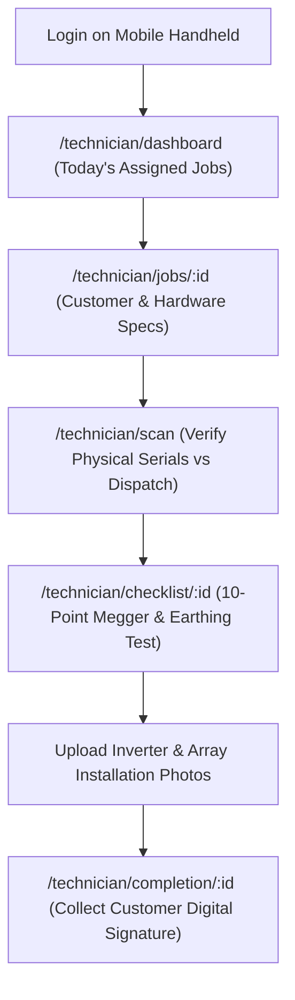
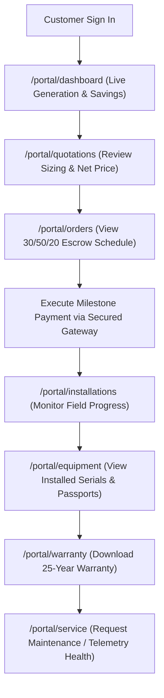

# SunPower One — Role-Based Access Control & Operational Workflow Matrix

> **System Truth Artifact**  
> **Classification:** Security Specification & RBAC Architecture  
> **Release Candidate:** SunPower One ERP v1.0.0  
> **Audited Standards:** ISO 27001 • SOC-2 Type II Principles • Zero-Trust Data Isolation

---

## 1. Overview & Identity Model

SunPower One operates on an enterprise **Zero-Trust Role-Based Access Control (RBAC)** architecture. Every user belongs to a strictly defined identity category with assigned operational permissions, workspace boundaries, and data mutability controls.

### 9 Canonical System Personas

| Persona ID | Identity Name | Assigned Role | Security Profile | Authorized Entry Route | Associated Workspace |
|---|---|---|---|---|---|
| `usr-01` | **Marcus Vance** | `director` | `admin` | `/app/dashboard` | Executive Operations Command Center |
| `usr-02` | **Elena Rostova** | `sales` | `employee` | `/app/crm/leads` | Sales Pipeline & Solar Sizing Terminal |
| `usr-03` | **Mateo Kowalski** | `survey` | `employee` | `/app/surveys` | Engineering Feasibility & Photogrammetry |
| `usr-04` | **Vikram Singh** | `warehouse` | `employee` | `/app/inventory` | Inventory & Hardware Serial Registry |
| `usr-05` | **David O'Connor** | `coordinator` | `employee` | `/app/installations` | Installation Projects & Field Scheduling |
| `usr-06` | **Priya Patel** | `finance` | `employee` | `/app/invoices` | Billing, Escrow Receipts & P&L Analysis |
| `usr-07` | **Aisha Khan** | `support` | `employee` | `/app/service` | Customer Service & Zero-Cost RMA Desk |
| `usr-08` | **Field Crew Chief** | `technician` | `technician` | `/technician/dashboard` | Mobile Field Commissioning Portal |
| `usr-09` | **Siddharth Varma** | `customer` | `customer` | `/portal/dashboard` | Customer Self-Service Solar Hub |

---

## 2. Granular Role Permission Matrix

| Operational Capability | Director / Admin | Sales Executive | Survey Engineer | Warehouse Manager | Installation Coordinator | Finance Specialist | Support Officer | Field Technician | Solar Customer |
|---|:---:|:---:|:---:|:---:|:---:|:---:|:---:|:---:|:---:|
| **Executive SCADA Dashboard** | **Full** | Read (Self) | None | None | Read (Crew) | Read (Fin) | None | None | None |
| **CRM Leads: Capture & Qualify** | **Full** | **Full** | None | None | None | None | None | None | None |
| **Site Survey: Schedule & Upload** | **Full** | Read | **Full** | None | Read | None | None | None | None |
| **Survey Adjudication (Pass/Fail)**| **Full** | None | **Full** | None | None | None | None | None | None |
| **System Sizing & Solar Calculator**| **Full** | **Full** | Read | None | None | None | None | None | Read (Public) |
| **BOM Generation & Margin Check** | **Full** | **Full** | None | Read | Read | Read | None | None | None |
| **Formal Quotations: Author & Issue**| **Full** | **Full** | None | None | None | None | None | None | Read/Accept |
| **Survey Approval Gate Enforcement**| **Full** | Strict Enforce | Enforce | None | None | None | None | None | None |
| **Sales Orders & Escrow Milestone**| **Full** | Read | None | Read | **Full** | Read | None | None | Pay Milestone |
| **Warehouse Stock Management** | **Full** | Read (Avail) | None | **Full** | Read | Read | None | None | None |
| **Serial Numbers: QR Token Issuance**| **Full** | None | None | **Full** | Read | None | Read | Verify Only | View Installed |
| **Order Picking & Dispatch Release**| **Full** | None | None | **Full** | None | None | None | None | None |
| **Field Crew Assignment & Dispatch**| **Full** | None | None | None | **Full** | None | None | View Assigned | View Assigned |
| **10-Point Safety Checklist** | **Full** | None | None | None | Verify | None | None | **Execute** | View Summary |
| **Customer Digital Sign-Off Pad** | **Full** | None | None | None | None | None | None | **Capture** | **Sign** |
| **Warranty Certificate Activation** | **Full** | Read | None | None | **Trigger** | Read | Read | None | Download |
| **RMA Warranty Claims Adjudication**| **Full** | None | None | Read | None | None | **Full** | Execute Visit | Submit |
| **Zero-Cost Warranty Replacement** | **Full** | None | None | Fulfill | None | Verify | **Adjudicate**| Install | None (No Fee) |
| **GST Tax Invoices & Milestone Billing**| **Full**| None | None | None | None | **Full** | None | None | Download Tax Inv|
| **Operational Expenses & Crew Payouts**| **Full**| None | None | None | Verify Hours | **Disburse** | None | View Own Payout| None |
| **PM Surya Ghar Subsidy Tracking** | **Full** | Read | None | None | Track Status | **Claim Sub.** | None | None | View Sub. Credit|
| **Project Profitability & Margins** | **Full** | View Deal Margin| None | None | None | **Full P&L** | None | None | None |
| **System Settings & Role Switching** | **Full** | None | None | None | None | None | None | None | None |

---

## 3. Detailed Workflow Maps per Persona

### 3.1. Executive Director (`admin@sunpower-solutions.com`)

### 3.2. Sales Executive (`sales@demo.com`)

### 3.3. Site Survey Engineer (`survey@demo.com`)

### 3.4. Warehouse Manager (`warehouse@demo.com`)

### 3.5. Installation Coordinator (`coordinator@demo.com`)

### 3.6. Billing & Finance Specialist (`finance@demo.com`)

### 3.7. Customer Support Officer (`support@demo.com`)

### 3.8. Field Technician (`tech@demo.com`)

### 3.9. Solar Customer (`customer@demo.com`)

---

## 4. Security Enforcement & Data Guardrails

1. **Authentication Gatekeeper:** Public unauthenticated visitors cannot access `/app/*`, `/technician/*`, or `/portal/*`. Any direct URL query redirects to `/login`.
2. **Profile Isolation:** Customers cannot navigate to internal ERP routes. Employee profiles cannot access Executive Director settings without verified admin credentials.
3. **Session Integrity:** Local storage sessions persist the verified authentication token, assigned profile, and HSM role token. User menu sign-out instantly flushes session storage and redirects to `/login`.

