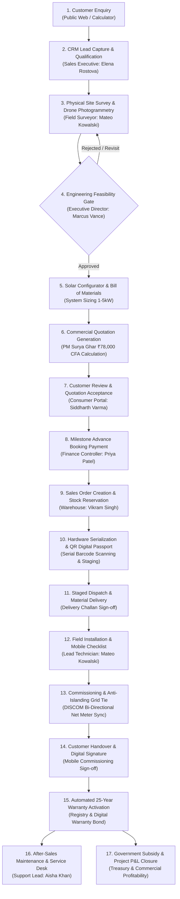

# SunPower One - End-to-End Solar Lifecycle Workflow Map

**Design Authority:** Google Stitch Project `11813858513178811754` ("SunPower Solar ERP")  
**Theme:** Warm Architectural Precision (Navy `#172747`, Espresso `#493027`, Sand `#F7F3EC`, Gold `#B68B55`)  
**Standard:** IEC 62446 Grid-Connected PV Quality Standard & MNRE PM Surya Ghar Operational Guidelines  
**Date:** 2026-11-04  

---

## 1. High-Level Solar Lifecycle Pipeline

---

## 2. Granular Stage-by-Stage Operational Map

### Stage 1: Customer Enquiry & Instant Sizing
- **Channel:** Public Website ([`HomePage.tsx`](file:///C:/Users/shari/Desktop/Hackathons/OODO/SUNPOWER-ONE/src/pages/public/HomePage.tsx), [`SolarCalculatorPage.tsx`](file:///C:/Users/shari/Desktop/Hackathons/OODO/SUNPOWER-ONE/src/pages/public/SolarCalculatorPage.tsx), [`RequestSurveyPage.tsx`](file:///C:/Users/shari/Desktop/Hackathons/OODO/SUNPOWER-ONE/src/pages/public/RequestSurveyPage.tsx)).
- **Input Parameters:** Monthly power bill (₹), connected DISCOM sanctioned load (kW), roof type (RCC Slab / Metal Tin Shed), shadow profile.
- **Instant Output:** Recommended capacity (e.g. 4.0 kW DC), annual generation estimate (~5,840 units), lifetime 25-year financial savings (₹18.4 Lakhs), and PM Surya Ghar CFA subsidy eligibility (₹78,000).
- **Outcome:** Lead record created in `leads` table with status `new`.

### Stage 2: CRM Qualification & Field Survey Dispatch
- **Actor:** Elena Rostova (`usr-02`, Lead Sales Executive).
- **Module:** [`CrmPage.tsx`](file:///C:/Users/shari/Desktop/Hackathons/OODO/SUNPOWER-ONE/src/pages/app/crm/CrmPage.tsx) (`/app/crm/leads`).
- **Actions:** Sales executive calls consumer, verifies electricity connection consumer number (e.g., BESCOM 10-digit ID), reviews rooftop satellite azimuth, and schedules technical survey.
- **Outcome:** Status advances to `survey_scheduled`. Field survey ticket generated (`SRV-2026-0041`).

### Stage 3: Site Inspection, Measurements & Photogrammetry
- **Actor:** Mateo Kowalski (`usr-03`, Certified Field Surveyor).
- **Module:** [`SurveysPage.tsx`](file:///C:/Users/shari/Desktop/Hackathons/OODO/SUNPOWER-ONE/src/pages/app/surveys/SurveysPage.tsx) (`/app/surveys`).
- **Measurements Captured:**
  - Total roof area: `650 sq ft`.
  - Shadow-free usable footprint: `480 sq ft`.
  - Azimuth: `South @ 14° Tilt`.
  - Cable run distance: `28 meters` to AC distribution board.
  - Structural base: `Good - RCC Slab`.
  - DISCOM feeder suitability: `Optimal`.
- **Photogrammetry Submission:** High-resolution orthomosaic drone photographs capturing parapet shadows, tilt inclinometer calibration, and proposed panel layout.
- **Outcome:** Survey marked `pending_approval`.

### Stage 4: Engineering Feasibility Gate (Executive Gating)
- **Actor:** Marcus Vance (`usr-01`, Executive Director & Chief Engineer).
- **Module:** [`SurveysPage.tsx`](file:///C:/Users/shari/Desktop/Hackathons/OODO/SUNPOWER-ONE/src/pages/app/surveys/SurveysPage.tsx).
- **Gating Rule:** No commercial quotation can be approved or generated without director sign-off on technical feasibility.
- **Actions:** Director inspects shading loss index (< 3.5%), structural loading calculation, and signs off.
- **Outcome:** Survey status changes to `approved` (`approvedBy: "Marcus Vance (Director)"`).

### Stage 5: Solar Configurator & Bill of Materials (BOM)
- **Actors:** Elena Rostova (`usr-02`) & Marcus Vance (`usr-01`).
- **Modules:** [`ConfiguratorPage.tsx`](file:///C:/Users/shari/Desktop/Hackathons/OODO/SUNPOWER-ONE/src/pages/app/configurator/ConfiguratorPage.tsx) & [`BomPage.tsx`](file:///C:/Users/shari/Desktop/Hackathons/OODO/SUNPOWER-ONE/src/pages/app/bom/BomPage.tsx).
- **Engineering Specification (4.0 kW On-Grid Example):**
  - **PV Modules:** 8x SunPower 540W Monocrystalline PERC Modules (4.32 kW DC total).
  - **Inverter:** 1x 5kW Dual MPPT Grid-Tie String Inverter (Anti-Islanding IEC 62116 compliant).
  - **Mounting Hardware:** Anodized Aluminium HDG Rail Structure with SS304 Mid/End Clamps (150 km/h wind certified).
  - **BOS & Protection:** Dual DC Surge Protection Device (SPD Type II), AC Isolator Box, 4mm² UV-resistant Solar DC cable (28m), Pure Copper Chemical Earthing Rods (3 pits: Inverter, Array, Lightning Arrester).
- **Outcome:** System Bill of Materials locked and priced.

### Stage 6: Commercial Quotation & Subsidy Calculation
- **Actor:** Elena Rostova (`usr-02`).
- **Module:** [`QuotationsPage.tsx`](file:///C:/Users/shari/Desktop/Hackathons/OODO/SUNPOWER-ONE/src/pages/app/quotations/QuotationsPage.tsx).
- **Financial Architecture (MNRE PM Surya Ghar Guideline):**
  - Gross Project Cost (excl. tax): ₹2,55,000
  - GST (12% Concessional Solar EPC Rate): ₹30,600
  - Total Commercial Value: ₹2,85,600
  - Central Financial Assistance (MNRE Subsidy CFA): -₹78,000 (Maximum direct DBT subsidy for ≥ 3kW residential systems)
  - Net Customer Payable Amount: ₹2,07,600
- **Outcome:** Quotation `QTN-2026-0089` published to Customer Portal.

### Stage 7 & 8: Customer Acceptance & Booking Advance
- **Actor:** Siddharth Varma (`usr-09`, Customer) & Priya Patel (`usr-06`, Finance).
- **Modules:** [`PortalPages.tsx`](file:///C:/Users/shari/Desktop/Hackathons/OODO/SUNPOWER-ONE/src/pages/portal/PortalPages.tsx) (`/portal/quotations`) & [`PaymentsPage.tsx`](file:///C:/Users/shari/Desktop/Hackathons/OODO/SUNPOWER-ONE/src/pages/app/payments/PaymentsPage.tsx).
- **Actions:** Customer reviews system specifications and clicks "Accept Quotation & Authorize Booking". Customer pays 20% advance booking deposit (₹41,520).
- **Outcome:** Quotation status `accepted`; Sales Order `ORD-2026-0042` generated; Payment receipt issued.

### Stage 9 & 10: Stock Reservation, Hardware Serialization & QR Digital Passports
- **Actor:** Vikram Singh (`usr-04`, Warehouse Manager).
- **Modules:** [`SerialsPage.tsx`](file:///C:/Users/shari/Desktop/Hackathons/OODO/SUNPOWER-ONE/src/pages/app/inventory/SerialsPage.tsx) & [`DispatchPage.tsx`](file:///C:/Users/shari/Desktop/Hackathons/OODO/SUNPOWER-ONE/src/pages/app/inventory/DispatchPage.tsx).
- **Provenance Protocol:**
  - Barcode scanners record exact serial numbers for all 8 PV modules (`MOD-540W-2026-0081` through `0088`) and the central inverter (`INV-5KW-2026-0021`).
  - System generates encrypted QR Digital Passports linking manufacturer flash test data, cell efficiency certificates, and warranty IDs.
  - Serials transition from `in_stock` to `reserved` to `dispatched`.

### Stage 11 & 12: Field Deployment, Technical Checklist & Commissioning
- **Actor:** Mateo Kowalski (`usr-08`, Lead Field Commissioning Technician).
- **Module:** Technician Mobile Experience ([`TechnicianPages.tsx`](file:///C:/Users/shari/Desktop/Hackathons/OODO/SUNPOWER-ONE/src/pages/technician/TechnicianPages.tsx)).
- **Sequential Commissioning Checklist:**
  1. Structural Rail Alignment & Torque Spec Verification (SS304 bolts torqued to 15 Nm).
  2. PV String Open Circuit Voltage ($V_{oc}$) & Short Circuit Current ($I_{sc}$) test.
  3. Chemical Earthing Pit Resistance measurement (< 2.0 Ohms).
  4. DC Isolator & AC Distribution Board Wiring audit.
  5. Inverter Grid Frequency & Voltage Synchronization (230V / 50Hz ± 0.5%).
  6. Bi-Directional Net Meter Integration with DISCOM utility feed.
- **Outcome:** Installation status advances to `commissioned`.

### Stage 13 & 14: Handover Sign-off & Digital Signature
- **Actors:** Mateo Kowalski (`usr-08`) & Siddharth Varma (`usr-09`).
- **Module:** [`TechnicianPages.tsx`](file:///C:/Users/shari/Desktop/Hackathons/OODO/SUNPOWER-ONE/src/pages/technician/TechnicianPages.tsx) (`/technician/jobs/:id/complete`).
- **Actions:** Field tablet displays the IEC 62446 commissioning certificate. Customer reviews telemetry live readings, inspects rooftop installation photographs, and signs on-screen.
- **Outcome:** Status advances to `handover_completed`.

### Stage 15: Automated 25-Year Warranty Activation
- **Automated Trigger:** `activate_warranty_on_delivery()` executes immediately upon handover sign-off.
- **Certificates Generated:**
  - 25-Year Linear Performance Warranty on Monocrystalline Panels (minimum 84.8% output at Year 25).
  - 10-Year Inverter Replacement Bond with dual MPPT surge coverage.
  - 5-Year Comprehensive Workmanship & Roof Penetration Weatherproofing Guarantee.
- **Consumer Visibility:** Customer accesses digital warranty certificates anytime via `/portal/warranties`.

### Stage 16: Post-Sales Monitoring & Service Desk
- **Actors:** Aisha Khan (`usr-07`, Support Lead) & Siddharth Varma (`usr-09`).
- **Modules:** [`ServiceDeskPage.tsx`](file:///C:/Users/shari/Desktop/Hackathons/OODO/SUNPOWER-ONE/src/pages/app/service/ServiceDeskPage.tsx) & `/portal/support`.
- **Telemetry Monitoring:** Inverter IoT telemetry streams daily kWh yield. If generation dips below 85% of expected irradiation model, an automated service ticket is generated.
- **Adjudication SLA:** High-priority tickets dispatched within 4 hours; customer confirmation mandatory before ticket closure.

### Stage 17: PM Surya Ghar CFA Subsidy & Financial Closure
- **Actor:** Priya Patel (`usr-06`, Commercial Finance Controller).
- **Modules:** [`SubsidiesPage.tsx`](file:///C:/Users/shari/Desktop/Hackathons/OODO/SUNPOWER-ONE/src/pages/app/subsidies/SubsidiesPage.tsx) & [`ProfitabilityPage.tsx`](file:///C:/Users/shari/Desktop/Hackathons/OODO/SUNPOWER-ONE/src/pages/app/profitability/ProfitabilityPage.tsx).
- **Execution:** Commissioning certificate uploaded to PM Surya Ghar National Portal; DISCOM approves net metering inspection; Direct Benefit Transfer (DBT) of ₹78,000 credited to consumer account.
- **Profitability Ledger:** Project P&L consolidates gross revenue, equipment procurement costs, direct technician labor payout, and transport overhead, calculating exact net margin (typically 22.4% - 28.5%).

